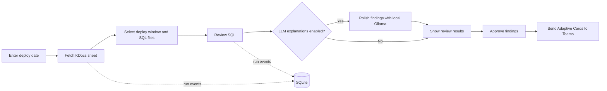

# SQL Reviewer

SQL Reviewer is a Python application for reviewing deployment SQL. It includes a PostgreSQL syntax and content review engine, a Playwright-based KDocs sheet fetcher, optional local LLM explanations, a FastAPI dashboard, and a Teams Adaptive Card notifier.

## Project instructions

- Run commands from the repository root. The application reads `config.yaml` and stores its SQLite database in the current working directory.
- Configure behavior in `config.yaml`; keep credentials and local settings out of source control.
- A KDocs account is needed to fetch a live deployment sheet. The first browser run may require scanning the WeChat QR code; the browser profile is kept in `browser-profile/`.
- Set the Teams webhook URL in the environment variable named by `teams_webhook_url_env` (default: `TEAMS_WEBHOOK_URL`) before using Teams notification.
- Ollama is optional. For local explanations, run Ollama, install the configured model (`qwen2.5-coder:3b`), and leave `llm_enabled: true`. Set `llm_enabled: false` to skip LLM calls.
- Run tests with `python -m pytest`.

## Tech stack

- Python 3.10+
- FastAPI and Uvicorn for the dashboard and API
- Playwright for browser automation; OpenPyXL for exported spreadsheets
- pglast and chardet for SQL parsing and encoding detection
- SQLite for run and event data
- HTTPX for Ollama and Teams webhook requests
- PyYAML for `config.yaml`; pytest for tests

## Workflow



## Getting started

Create and activate a virtual environment from the repository root:

```powershell
py -m venv .venv
.\.venv\Scripts\Activate.ps1
```

Install the dependencies and the Playwright Chromium browser:

```powershell
python -m pip install fastapi "uvicorn[standard]" httpx openpyxl playwright pglast chardet pyyaml pytest
python -m playwright install chromium
```

Review `config.yaml` and adjust the deployment request prefixes, required locale, KDocs login timeout, LLM settings, and Teams pacing/retry settings as needed.

Start the dashboard:

```powershell
python -m uvicorn ui.main:app --reload
```

Open <http://127.0.0.1:8000>, enter a deployment date in `MM.DD` format, and start a review. The first KDocs visit may pause while you sign in.

To enable Teams notifications in the current PowerShell session, set the webhook URL before starting the server:

```powershell
$env:TEAMS_WEBHOOK_URL = "https://your-webhook-url"
```

Run the test suite:

```powershell
python -m pytest -q
```

## Current implementation notes

The dashboard and API are under active development. The review findings endpoint and approve/edit/reject actions are currently placeholders, and dispatch is not yet wired to send approved findings. Also, the pipeline currently passes fetched SQL text to a review method that expects a file path, so a live pipeline run may fail during SQL review. These integration gaps should be resolved before relying on the dashboard for deployment approval or Teams delivery.
